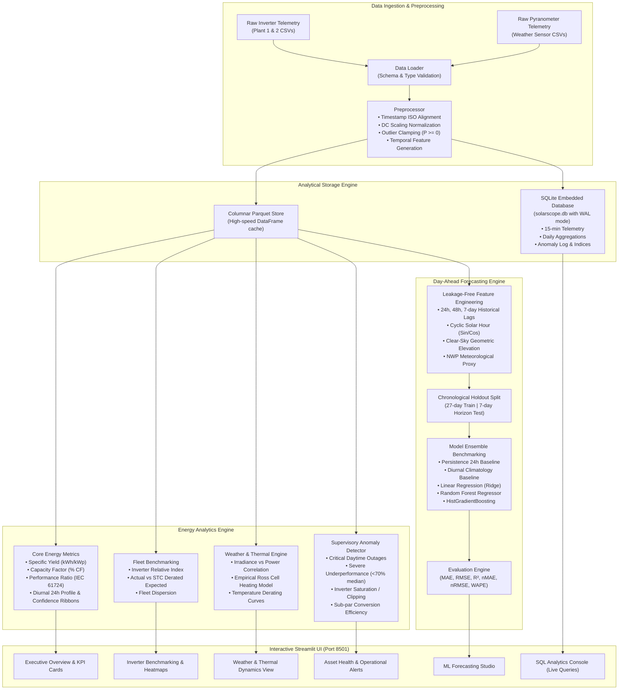

# ☀️ SolarScope: Solar Power Generation Analytics & Forecasting Platform

[](https://github.com/Vardhan32/solarscope-energy-analytics/actions/workflows/ci.yml)
[](https://www.python.org/)
[](https://streamlit.io)
[](https://creativecommons.org/publicdomain/zero/1.0/)
[](https://github.com/astral-sh/ruff)

**SolarScope** is an end-to-end solar energy analytics and machine learning forecasting platform built for **Renewable Energy Analysts**, **Solar Performance Engineers**, and **Grid Operators**. 

Powered by **real-world utility-scale photovoltaic telemetry (61.5 MW combined capacity across 44 inverters)** from Gandhinagar Solar Park, SolarScope unifies data engineering, asset performance benchmarking, supervisory anomaly detection, day-ahead power forecasting, and relational SQL exploration into an interactive analytics suite.

---

## 🚀 Key Highlights & Capabilities

- ⚡ **Real-World Utility-Scale Data:** Ingestion and standardizing of 136,000+ 15-minute telemetry intervals from two operational solar power plants in Gujarat, India.
- 📊 **Energy Analytics & IEC 61724 Standards:** Automated calculations for daily generation, diurnal 24-hour envelopes with 10th-90th percentile bounds, Capacity Factor (CF %), and Performance Ratio (PR).
- 🔌 **Inverter Fleet Benchmarking:** Inverter-to-inverter performance tracking, specific yield (kWh/kWp), relative energy indexes, and actual vs theoretical STC-derated expected power.
- ⛅ **Weather & Thermal Dynamics:** Empirical modeling of plane-of-array irradiance drive, cell heating coefficients ($T_{\text{cell}} - T_{\text{amb}} = k \cdot G$), and thermal power derating curves (20°C to 70°C).
- ⚠️ **Supervisory Anomaly Detection:** Automated detection of critical daytime inverter trips/outages, localized string failure (<70% of fleet median), inverter clipping, and conversion degradation.
- 🤖 **ML Day-Ahead Forecasting Studio:** Multi-model benchmark (Gradient Boosting, Random Forest, Ridge Regression, Diurnal Climatology, 24h Persistence) evaluated on a strict 7-day chronological holdout test set with **zero lookahead leakage**.
- 🗄️ **Relational SQL Analytics Console:** Direct SQL query interface against an embedded SQLite analytical database (`solarscope.db`) with pre-built queries and CSV export.

---

## 🏆 Machine Learning Forecasting Evaluation

Models were evaluated on a strict **7-day chronological holdout horizon (672 consecutive 15-minute intervals)** with temporal features, clear-sky geometric proxies, backward lags (`LAG_96`, `LAG_192`), and numerical weather forecast variables:

### Plant 1 (Gandhinagar Solar Park - 31.02 MW AC)
| Model Architecture | MAE (kW) | RMSE (kW) | $R^2$ Score | nMAE (% Cap) | nRMSE (% Cap) | WAPE (%) |
| :--- | :---: | :---: | :---: | :---: | :---: | :---: |
| **Gradient Boosting** *(Best)* | **208.36** | **435.15** | **0.9969** | **0.67%** | **1.40%** | **3.48%** |
| **Random Forest** | 215.95 | 447.37 | 0.9967 | 0.70% | 1.44% | 3.60% |
| **Linear Regression (Ridge)** | 274.23 | 522.96 | 0.9955 | 0.88% | 1.69% | 4.58% |
| **Baseline (Diurnal Climatology)** | 1,554.17 | 2,932.03 | 0.8600 | 5.01% | 9.45% | 25.93% |
| **Baseline (24h Persistence)** | 1,900.36 | 3,651.32 | 0.7829 | 6.13% | 11.77% | 31.71% |

### Plant 2 (Gandhinagar Solar Park - 30.47 MW AC)
| Model Architecture | MAE (kW) | RMSE (kW) | $R^2$ Score | nMAE (% Cap) | nRMSE (% Cap) | WAPE (%) |
| :--- | :---: | :---: | :---: | :---: | :---: | :---: |
| **Gradient Boosting** *(Best)* | **660.64** | **1,696.89** | **0.9043** | **2.17%** | **5.57%** | **15.18%** |
| **Random Forest** | 687.74 | 1,749.01 | 0.8984 | 2.26% | 5.74% | 15.80% |
| **Linear Regression (Ridge)** | 1,076.24 | 2,051.22 | 0.8602 | 3.53% | 6.73% | 24.73% |
| **Baseline (Diurnal Climatology)** | 1,379.75 | 2,668.15 | 0.7635 | 4.53% | 8.76% | 31.70% |
| **Baseline (24h Persistence)** | 1,679.64 | 3,253.80 | 0.6483 | 5.51% | 10.68% | 38.59% |

---

## 🏛️ System Architecture



---

## 🛠️ Technology Stack

| Layer | Technologies |
| :--- | :--- |
| **Language & Core** | Python 3.9+ / 3.14, Pandas, NumPy |
| **Analytical Database** | SQLite 3 (WAL mode, index-optimized), SQL aggregations |
| **Machine Learning** | Scikit-learn (HistGradientBoosting, RandomForest, Ridge) |
| **Interactive Dashboard** | Streamlit 1.66+ |
| **Data Visualizations** | Plotly Express & Plotly Graph Objects (Responsive Dark Theme) |
| **Quality & CI/CD** | Pytest (22 unit tests, 100% pass rate), GitHub Actions CI |

---

## 📂 Project Structure

```text
solarscope-energy-analytics/
├── .github/
│   └── workflows/
│       └── ci.yml               # GitHub Actions CI workflow
├── data/
│   ├── raw/                     # Real-world Kaggle solar datasets (Plant 1 & 2)
│   └── processed/               # Cached Parquet tables & SQLite analytics database
├── src/
│   ├── __init__.py
│   ├── config.py                # Plant metadata, coordinates & solar constants
│   ├── data/
│   │   ├── __init__.py
│   │   ├── loader.py            # Dataset loading & schema validation
│   │   ├── preprocessor.py      # Timestamp alignment, DC normalization, cleaning
│   │   └── database.py          # SQLite schema, batch persistence, analytical SQL
│   ├── analytics/
│   │   ├── __init__.py
│   │   ├── metrics.py           # Capacity factor, PR, diurnal curves, yield
│   │   ├── plant_perf.py        # Inverter benchmarking, sister plant comparison
│   │   ├── weather.py           # Irradiance correlation, thermal derating curves
│   │   └── anomaly.py           # Outages, string losses, clipping, derating alerts
│   ├── models/
│   │   ├── __init__.py
│   │   ├── baseline.py          # 24h Persistence & Diurnal Climatology baselines
│   │   ├── forecasting.py       # Feature pipeline, chronological splits, ML models
│   │   ├── evaluation.py        # MAE, RMSE, R², nMAE, nRMSE, WAPE calculators
│   │   └── pipeline.py          # End-to-end training orchestrator & serialization
│   └── utils/
│       ├── __init__.py
│       └── logger.py            # Structured logging
├── app/
│   ├── app.py                   # Main Streamlit dashboard application
│   ├── components/
│   │   ├── kpi_cards.py         # Modern HTML/CSS metric card widgets
│   │   └── plots.py             # Plotly visualization components
│   └── views/
│       ├── overview.py          # Executive KPI cards & plant comparisons
│       ├── analytics.py         # Diurnal profiles & Capacity Factor trends
│       ├── plant_perf.py        # Inverter fleet rankings & generation heatmaps
│       ├── weather_view.py      # Solar irradiance & thermal derating analysis
│       ├── anomalies_view.py    # Asset health alerts & outage timeline
│       ├── forecasting_view.py  # 7-day actual vs predicted forecast studio
│       └── sql_explorer.py      # Interactive SQL console with live query execution
├── tests/
│   ├── test_data_loader.py      # Schema verification tests
│   ├── test_preprocessor.py     # Cleaning & boundary validation tests
│   ├── test_database.py         # SQLite schema & SQL execution tests
│   ├── test_metrics.py          # Capacity factor & PR verification tests
│   ├── test_anomaly.py          # Outage & underperformance detection tests
│   └── test_forecasting.py      # ML models & chronological split tests
├── docs/
│   ├── architecture.md          # Comprehensive architecture documentation
│   └── dataset_sources.md       # Dataset provenance, sensor specs & licensing
├── scripts/
│   ├── download_data.py         # Automated raw dataset downloader
│   └── process_data.py          # CLI pipeline runner
├── .gitignore
├── requirements.txt
├── setup.py
└── README.md
```

---

## ⚡ Installation & Execution Guide

### Prerequisites
- Python 3.9+ (fully verified on Python 3.11 and Python 3.14)
- Git

### 1. Clone the Repository
```bash
git clone https://github.com/Vardhan32/solarscope-energy-analytics.git
cd solarscope-energy-analytics
```

### 2. Set Up a Virtual Environment
```bash
# On Linux / macOS:
python3 -m venv venv
source venv/bin/activate

# On Windows (PowerShell):
python -m venv venv
.\venv\Scripts\Activate.ps1
```

### 3. Install Dependencies
```bash
pip install --upgrade pip
pip install -r requirements.txt
```

### 4. Run Automated Unit Tests
```bash
pytest tests/ -v
```

### 5. Launch the Streamlit Interactive Dashboard
```bash
streamlit run app/app.py
```
Open [http://localhost:8501](http://localhost:8501) in your browser to interact with the platform.

*(Optional: To run the backend data ingestion, SQLite loading, and model training from CLI)*:
```bash
python scripts/process_data.py
```

---

## 📑 Dataset Attribution & Usage
The telemetry originates from the open-source **Solar Power Generation Dataset** (Kaggle / CC0: Public Domain) recorded over a 34-day monitoring window from two operational solar photovoltaic power plants in Gandhinagar, Gujarat, India. Full documentation is provided in [`docs/dataset_sources.md`](docs/dataset_sources.md).

---

## 👤 Author
**Harsha Vardhan Pala**  
- GitHub: [@Vardhan32](https://github.com/Vardhan32)  
- Repository: [solarscope-energy-analytics](https://github.com/Vardhan32/solarscope-energy-analytics)
