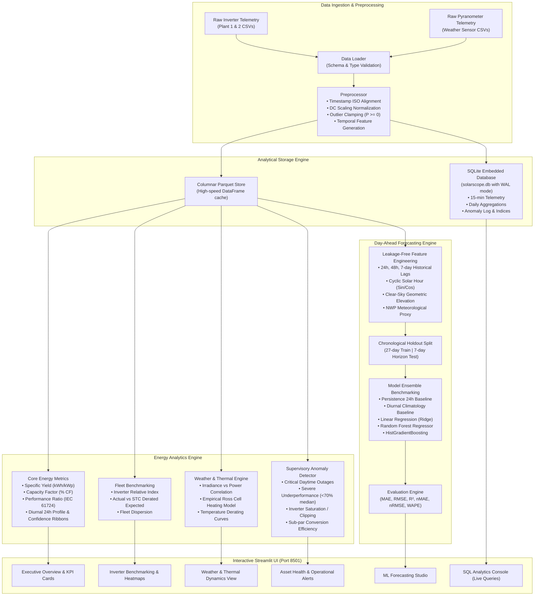

# SolarScope System Architecture

SolarScope is built on a clean, decoupled, layered architecture adhering to modern software engineering and renewable energy analytics practices.

---

## 1. High-Level Architecture Diagram

---

## 2. Core Modules Description

### `src/config.py`
Centralizes project paths, plant nameplate configurations (capacity, inverter counts, coordinate metadata), solar test constants (STC = 1000 W/m², T_stc = 25°C, $\gamma = -0.4\%/^\circ\text{C}$), and operational anomaly threshold boundaries.

### `src/data/`
- **`loader.py`:** Handles verification of raw telemetry files and enforces schema integrity across generation and meteorological sources.
- **`preprocessor.py`:** Standardizes date parsing (reconciling DD-MM-YYYY and ISO conventions), scales DC power to uniform kW, clamps negative physical artifacts, and computes 15-minute interval energy ($E_{\text{interval}} = P_{\text{ac}} \times 0.25\text{ h}$).
- **`database.py`:** Manages schema creation, indexing on `(plant_id, date_time, source_key)`, write-ahead logging (WAL), batch persistence, and analytical query execution.

### `src/analytics/`
- **`metrics.py`:** Computes daily aggregated yield, rolling 7-day moving averages, diurnal 24-hour envelopes with 10th-90th percentile bounds, Capacity Factor ($CF = \frac{E_{\text{actual}}}{P_{\text{rated}} \times 24\text{ h}}$), and standard IEC 61724 Performance Ratio ($PR = \frac{Y_f}{Y_r}$).
- **`plant_perf.py`:** Compares sister plants side-by-side, tracks inverter-level relative performance index against fleet medians, and fits theoretical temperature-derated generation models ($P_{\text{exp}} = P_{\text{rated}} \times \frac{G}{G_{\text{stc}}} \times [1 + \gamma(T_{\text{mod}} - 25)]$).
- **`weather.py`:** Analyzes plane-of-array irradiance correlation, models cell heating ($T_{\text{cell}} - T_{\text{amb}} = k \cdot G$), and constructs empirical temperature derating curves.
- **`anomaly.py`:** Executes rule-based and fleet-comparative anomaly detection identifying inverter trips during daylight, localized string losses, clipping, and conversion degradation.

### `src/models/`
- **`baseline.py`:** Implements 24-hour persistence and historical diurnal climatology benchmarks.
- **`forecasting.py`:** Implements leakage-free feature pipelines with historical lags (`LAG_96`, `LAG_192`), rolling statistics, and trains Ridge, Random Forest, and HistGradientBoostingRegressor models.
- **`evaluation.py`:** Computes absolute and capacity-normalized error metrics (MAE, RMSE, R², nMAE, nRMSE, WAPE).
- **`pipeline.py`:** Orchestrates end-to-end data ingestion, database loading, anomaly detection, and serialized model artifact generation.

### `app/`
Modular Streamlit application providing 7 distinct analytical workspaces with Plotly interactive charts and SQL query exploration.
